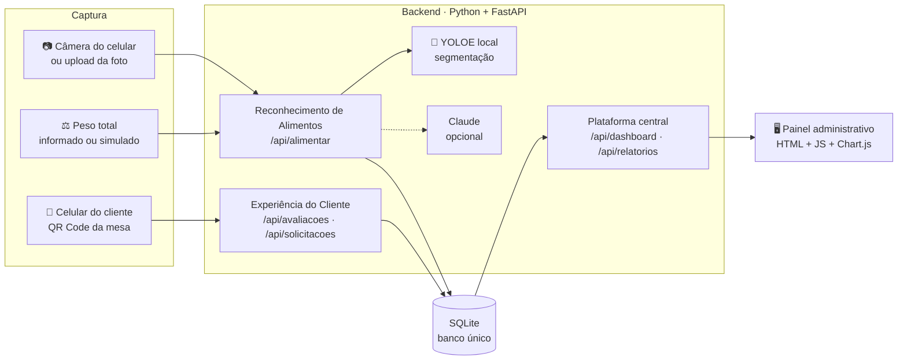

<p align="center">
  
</p>

<h1 align="center">Code Meat | Intelligence Platform</h1>

<p align="center">
  <b>Reconhecimento inteligente de alimentos e experiência do cliente em uma única plataforma.</b><br>
  Hackathon FMU Tech 2026.2 · Desafio Bovinu'S Grill &amp; Beer (unidade Augusta)
</p>

<p align="center">
  <a href="#-vídeo-de-demonstração">🎬 Vídeo</a> ·
  <a href="#-apresentação">📊 Apresentação</a> ·
  <a href="#-como-executar">▶️ Como executar</a> ·
  <a href="docs/ARQUITETURA.md">🏗️ Arquitetura</a> ·
  <a href="docs/RECONHECIMENTO.md">🤖 Reconhecimento</a>
</p>


---

## 📌 Resumo

O **Code Meat** junta duas informações que o restaurante hoje não enxerga durante o almoço: **o que está no prato** (e o que volta como sobra) e **o que o cliente está sentindo** (nota, reclamação, pedido de atendimento). Tudo é gravado no **mesmo banco de dados** e aparece em **um único painel**.

## ❗ Problema

No pico do almoço (12h às 13h30) dois problemas aparecem juntos:

| | Problema | Consequência |
|---|---|---|
| 🍽️ | **Consumo e sobras invisíveis** | Não se sabe o que mais sai e o que mais sobra, nem em que horário. |
| 💬 | **Feedback que chega tarde** | O problema do cliente só aparece quando ele já foi embora. |

## 💡 Solução

Uma plataforma web com dois pilares integrados e um dashboard central:

| Pilar | O que faz |
|---|---|
| **1. Reconhecimento Inteligente de Alimentos** | Foto do prato pela **câmera do celular** ou upload. Um modelo de visão computacional que roda **no próprio computador** (YOLOE, sem custo de API) identifica e **contorna cada alimento** (carnes, arroz, feijão, batata frita, salada, frango, linguiça e acompanhamentos), mostra a **confiança** e marca como **"Não identificado"** o que não tem certeza. A balança informa só o **peso total**. Na volta do prato, registra-se a sobra. |
| **2. Experiência do Cliente** | **QR Code** na mesa abre uma página no celular, sem aplicativo e sem cadastro: avaliação por **emojis e estrelas**, **sugestão ou reclamação** e **pedido de atendimento**, que chega ao painel na hora. O painel mostra satisfação, reclamações e a fila de pedidos. |

**O diferencial é a integração.** O pedido feito pelo QR Code vira alerta na Visão Geral. O gráfico **Sinais integrados por horário** mostra no mesmo eixo pratos, desperdício, pedidos de atendimento e nota dos clientes.

## 🎯 Objetivo

Mostrar, com uma aplicação funcionando, como visão computacional e digitalização ajudam a Bovinu'S a **reduzir desperdício** e a **resolver o problema do cliente enquanto ele ainda está no salão**.

---

## 📸 Telas

| Reconhecimento de alimentos (painel) | Reconhecimento pelo celular |
|---|---|
|  |  |
| **Experiência do Cliente (painel + celular)** | **Relatórios integrados** |
|  |  |

## 🎬 Vídeo de demonstração

**[▶️ Assistir ao vídeo (até 2 minutos)](COLE_AQUI_O_LINK_DO_VIDEO)**

## 📊 Apresentação

**[📄 Apresentação em 5 slides (PDF)](docs/Code_Meat_Entrega_5_slides.pdf)** · [versão editável (PowerPoint)](docs/Code_Meat_Entrega_5_slides.pptx)

---

## ⚙️ Como funciona cada pilar

### Pilar 1 · Reconhecimento Inteligente de Alimentos
1. **Foto:** botão **Abrir câmera** (pré-visualização ao vivo no celular ou na webcam) ou **Enviar foto** (galeria, arquivo ou arrastar). A foto é reduzida no navegador para no máximo 1600 px antes do envio.
2. **Reconhecimento e segmentação:** o **YOLOE** (Ultralytics) roda no computador do restaurante e devolve, para cada região do prato, a categoria, a confiança e o **contorno** desenhado sobre a foto. Nos testes, sem placa de vídeo, levou entre 0,4 e 1 segundo por foto (o 1º uso demora mais porque carrega o modelo).
3. **Regras de confiança:** a partir de 55% = **Alta**, de 35% a 54% = **Média**, abaixo de 35% = **Não identificado** (o sistema não chuta). Prato, talheres e copos são detectados e **listados à parte**, porque não são comida.
4. **Conferência:** o operador confirma, remove ou adiciona alimentos. O registro guarda se cada item veio da IA ou foi marcado à mão.
5. **Peso total:** informado pelo operador ou **simulado** (botão "Gerar peso simulado"). O sistema **nunca mostra peso por alimento**: a balança pesa o prato inteiro.
6. **Prato devolvido:** peso da sobra e quais alimentos sobraram. Indicadores: desperdício (sobra ÷ peso servido), incidência de sobra por alimento e consumo por horário.

Motores de reconhecimento, em ordem: **YOLOE local** (padrão, gratuito) → **Claude** (opcional, API paga, só se configurado) → **marcação manual**. A tela sempre informa qual foi usado. Detalhes, licenças e resultados dos testes com fotos reais: **[docs/RECONHECIMENTO.md](docs/RECONHECIMENTO.md)**.

### Pilar 2 · Experiência do Cliente
- `/cliente/?mesa=N`: página para celular, aberta pelo QR Code da mesa. Anônima, sem cadastro.
- Avaliação geral em um toque (5 emojis, de Muito ruim a Excelente), notas opcionais em estrelas para atendimento e comida, e comentário.
- Sugestão ou reclamação com categoria.
- Pedido de atendimento: chamar garçom, pedir a conta, reposição no buffet ou limpeza da mesa.
- No painel: nota média, notas por aspecto, distribuição das notas, reclamações por categoria, fila de pedidos em tempo real com **Atender** e **Resolver**, e exportação em CSV.
- QR Codes de todas as mesas prontos para imprimir em **Configurações**.

---

## 🏗️ Arquitetura



- **Um único servidor** entrega a API, o painel (`/`) e a página do cliente (`/cliente/`).
- **Um único banco** (SQLite). Todas as ações gravam também na tabela `atividades`, a linha do tempo da plataforma.
- Toda tabela de registros tem a coluna **`origem_dado`** (`demo` ou `real`), para que nenhum dado fictício apareça como real.

Detalhes, modelo do banco e contratos da API: **[docs/ARQUITETURA.md](docs/ARQUITETURA.md)**. Documentação interativa da API: `http://localhost:8000/docs`.

## 🧰 Tecnologias

| Camada | Tecnologia | Licença |
|---|---|---|
| Backend | Python 3.10+, **FastAPI**, Uvicorn | MIT / BSD |
| Banco | **SQLite** | Domínio público |
| Frontend | HTML, CSS e JavaScript (módulos ES), sem etapa de build | (da equipe) |
| Reconhecimento local | **YOLOE** via **Ultralytics** 8.4 + PyTorch + CLIP (codificador de texto) | **AGPL-3.0** (Ultralytics e fork do CLIP), BSD (PyTorch) |
| Reconhecimento opcional | **Claude** (Anthropic), SDK `anthropic` | MIT (SDK); uso da API é pago |
| Imagens | **Pillow** | MIT-CMU |
| Gráficos | **Chart.js 4.4.1**, salvo no repositório | MIT |
| QR Code | **segno** | BSD |
| Fonte | **Inter** | SIL Open Font License |
| Testes | pytest + Playwright | MIT / Apache-2.0 |

**Desenvolvido pela equipe:** toda a aplicação (backend, banco, regras de negócio, integração com o modelo, regras de confiança, mapeamento de categorias, telas, captura pela câmera, página do cliente, dados demonstrativos e testes). **Integrado de terceiros:** as bibliotecas da tabela e os pesos pré-treinados do YOLOE. Nenhum modelo foi treinado pela equipe. FoodSAM e FoodInsSeg foram usados **apenas como referência conceitual** (nenhum código copiado); veja [docs/RECONHECIMENTO.md](docs/RECONHECIMENTO.md#referências-e-licenças).

---

## ▶️ Como executar

**Pré-requisito:** Python 3.10 ou mais recente ([python.org/downloads](https://www.python.org/downloads/); no Windows marque **"Add Python to PATH"**). O Git **não** é necessário para instalar: o pacote CLIP usado pelo YOLOE já vem na pasta `pacotes/`.

**Windows (mais fácil):** coloque o projeto numa pasta curta e fora do OneDrive, como `C:\code-meat`. Clique duas vezes em **`instalar_windows.bat`** (uma vez só) e depois em **`iniciar_windows.bat`**. O instalador cria um ambiente `.venv` dentro do projeto e instala tudo nele. Detalhes e erros comuns: [docs/GUIA_EQUIPE.md](docs/GUIA_EQUIPE.md#2-baixar-e-instalar-o-projeto).

**Linux, Mac ou Windows pelo terminal** (sempre dentro da pasta do projeto):

```bash
# 1. Baixe o projeto (ou extraia o .zip)
git clone https://github.com/jessetec03-code/OqueQuilo.git code-meat
cd code-meat

# 2. Crie um ambiente só do projeto (recomendado; no Windows é o que evita o erro de caminho longo)
python -m venv .venv
# Windows: .venv\Scripts\activate      Linux/Mac: source .venv/bin/activate

# 3. Instale o sistema (uma vez só)
python -m pip install -r requirements.txt

# 4. Instale o reconhecimento de alimentos local (uma vez só; baixa cerca de 1 a 3 GB)
python -m pip install -r requirements-visao.txt

# 5. Inicie
python run.py
```

Abra **http://localhost:8000**. Na primeira execução o banco é criado com dados demonstrativos e o modelo é baixado do GitHub da Ultralytics (cerca de 700 MB, uma única vez). Sem o passo 4, o sistema funciona normalmente com marcação manual dos alimentos.

| Comando | O que faz |
|---|---|
| `python run.py` | Inicia o sistema |
| `python run.py --reset` | Apaga o banco e recria os dados demonstrativos |
| `python -m pytest -q` | Roda os testes automáticos |
| `python -m scripts.avaliar_reconhecimento tests/fotos_reais` | Mede o reconhecimento em fotos reais (veja [docs/TESTES.md](docs/TESTES.md)) |

**Celular (cliente):** conecte o celular no mesmo Wi-Fi do computador e leia o QR Code de uma mesa (Configurações ou Experiência do Cliente). O endereço aparece no terminal ao iniciar.

**Celular (câmera do operador):** pelo endereço `http://192.168...` o botão **Tirar foto** usa a câmera nativa do celular. A câmera com pré-visualização ao vivo exige HTTPS (ou `localhost`), uma regra dos navegadores. Veja [docs/RECONHECIMENTO.md](docs/RECONHECIMENTO.md#testar-no-celular).

**Claude (opcional, pago):** `pip install -r requirements-ia.txt`, copie `.env.example` para `.env` e preencha `ANTHROPIC_API_KEY`. Só é usado se o YOLOE não estiver instalado ou com `MOTOR_VISAO=claude`.

> **Windows:** o Python da Microsoft Store instala pacotes numa pasta de caminho muito longo, e o PyTorch passa do limite de 260 caracteres do Windows (`OSError`). Com o `.venv` dentro de `C:\code-meat` isso não acontece. Evite o OneDrive: ele tenta sincronizar os vários GB do ambiente. Guia passo a passo: **[docs/GUIA_EQUIPE.md](docs/GUIA_EQUIPE.md)**.

---

## 🔍 O que é real, simulado ou planejado

| Funcionalidade | Situação no protótipo |
|---|---|
| Captura pela câmera do celular e upload | ✅ Real. Câmera ao vivo em HTTPS/localhost; câmera nativa do celular em HTTP. |
| Reconhecimento e segmentação dos alimentos | ✅ Real, com YOLOE local (testado com 6 fotos reais: 14 de 23 categorias encontradas, nenhum alimento inventado; [resultados](docs/RECONHECIMENTO.md#resultados-com-fotos-reais)). ⚠️ O modelo não foi treinado com comida brasileira: erra e deixa de reconhecer itens, por isso o operador confere. |
| Confiança e "Não identificado" | ✅ Real (confiança vem do modelo; limiares definidos pela equipe). |
| Peso do prato | ⚠️ **Informado** pelo operador ou **simulado**. Não há balança conectada. A opção "Balança conectada" aparece desativada. |
| Peso por alimento | ❌ Não existe, de propósito. A balança mede só o total. |
| QR Code, avaliações, reclamações, pedidos | ✅ Reais e integrados ao painel. |
| Indicadores e relatórios | ✅ Calculados do banco. Os dados iniciais são **demonstrativos e fictícios** (selo amarelo), não são dados da Bovinu'S. |
| Treino do modelo com pratos do restaurante, balança USB/Bluetooth, câmera fixa | 🔜 Planejado. |

Botões em **Configurações** permitem recriar ou remover os dados demonstrativos, mantendo os registros reais.

## 🔒 Privacidade (LGPD)

- A câmera olha o prato, não a pessoa. Nenhum reconhecimento facial.
- O reconhecimento local roda no computador do restaurante: a foto não sai dele.
- O cliente é anônimo: só o número da mesa é registrado.
- Nenhuma chave ou senha no repositório (`.env` está no `.gitignore`). Fotos de teste não vão para o GitHub.

## 🚀 Próximos passos

Ajuste fino (fine-tuning) do modelo com fotos de pratos da Bovinu'S, integração com balança via USB/Bluetooth, câmera fixa sobre a balança, notificação no celular do garçom e fidelização com consentimento.

## 👥 Equipe

Ciência da Computação · FMU

| Integrante | Responsabilidade |
|---|---|
| Integrante 1 | Arquitetura, backend, banco, integração do modelo de visão, testes e documentação |
| Integrante 2 | Reconhecimento de Alimentos: testes com fotos reais, gabarito, câmera no celular e demonstração |
| Integrante 3 | Experiência do Cliente: página do QR Code, painel de satisfação e pedidos |

<sub>Protótipo acadêmico. Marcas citadas pertencem aos seus donos. Dados exibidos nos indicadores são fictícios.</sub>
