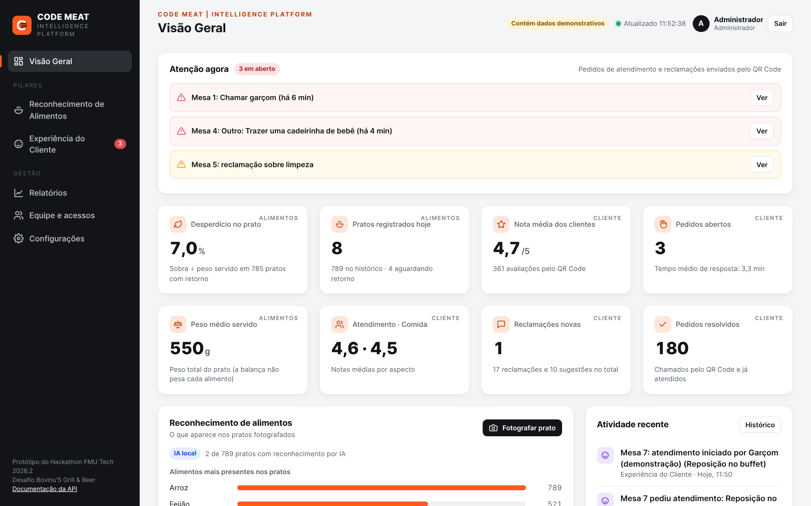
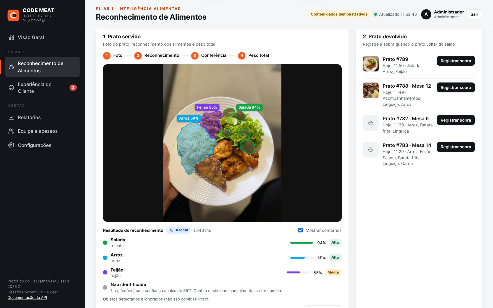
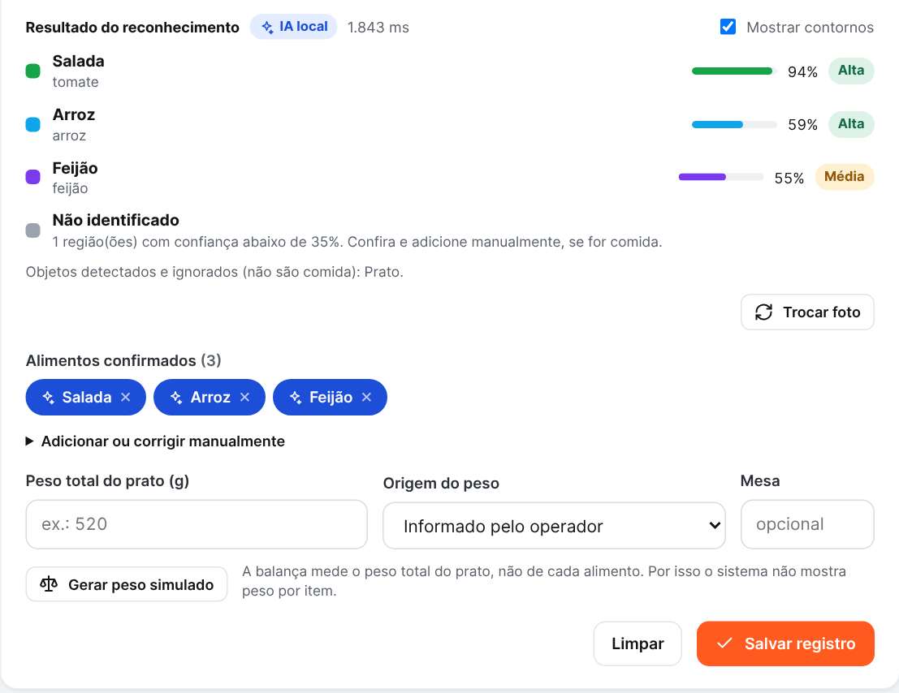
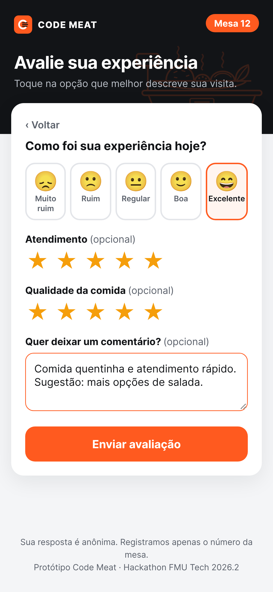
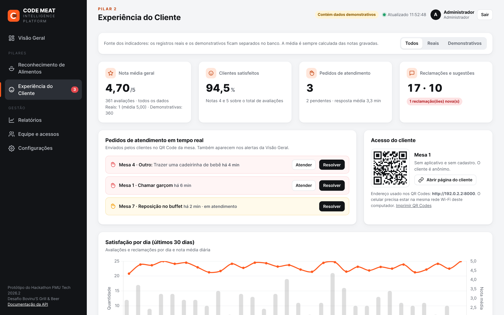
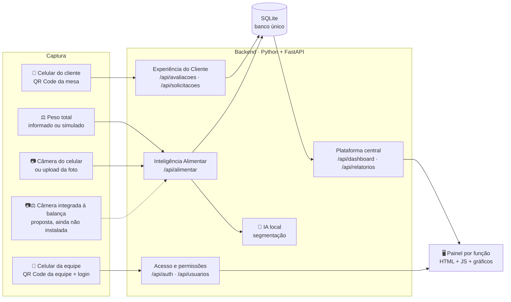

<p align="center">
  
</p>

<h1 align="center">Code Meat | Intelligence Platform</h1>

<p align="center">
  <b>Inteligência alimentar e experiência do cliente em uma única plataforma.</b><br>
  Hackathon FMU Tech 2026.2 · Desafio Bovinu'S Grill &amp; Beer (unidade Augusta)
</p>

<p align="center">
  <a href="#-vídeo-de-demonstração">🎬 Vídeo</a> ·
  <a href="#-apresentação">📊 Apresentação</a> ·
  <a href="#-como-executar">▶️ Como executar</a> ·
  <a href="#-demonstração-pelo-celular">📱 Demonstração</a> ·
  <a href="docs/ARQUITETURA.md">🏗️ Arquitetura</a>
</p>



---

## 📌 Resumo

Pensado para a realidade de um **restaurante de almoço por quilo (self-service)**, como a Bovinu'S, o **Code Meat** junta duas informações que o restaurante hoje não enxerga durante o almoço: **o que está no prato** (e o que volta como sobra) e **o que o cliente está sentindo** (nota, reclamação, pedido de atendimento). Tudo é gravado no **mesmo banco de dados** e aparece em **um único painel**, e cada colaborador vê só o que a sua função precisa.

## ❗ Problema

No pico do almoço (12h às 13h30) dois problemas aparecem juntos:

| | Problema | Consequência |
|---|---|---|
| 🍽️ | **Consumo e sobras invisíveis** | Não se sabe o que mais sai e o que mais sobra, nem em que horário. |
| 💬 | **Feedback que chega tarde** | O problema do cliente só aparece quando ele já foi embora. |

## 💡 Solução

Uma plataforma web com dois pilares integrados, um dashboard central e acesso da equipe por função:

| Pilar | O que faz |
|---|---|
| **1. Inteligência Alimentar** | **Proposta de funcionamento:** uma câmera integrada à balança captura a foto **automaticamente** quando o cliente coloca o prato para pesar, sem ação do cliente ou do funcionário, e a balança registra o **peso total**. **No protótipo, essa integração física ainda não está instalada:** a foto é enviada pela **câmera do celular** ou por upload, e o peso total é informado ou simulado. Uma IA de visão computacional que roda **no próprio computador do restaurante** (sem custo por foto) identifica e **contorna cada alimento** (carnes, arroz, feijão, batata frita, salada, frango, linguiça e acompanhamentos), mostra a **confiança** e marca como **"Não identificado"** o que não tem certeza. Na volta do prato, registra-se a sobra. |
| **2. Experiência do Cliente** | **QR Code** na mesa abre uma página no celular, sem aplicativo e sem cadastro: avaliação por **emojis e estrelas**, **sugestão ou reclamação** e **pedido de atendimento**, que chega ao painel na hora. Quando nenhuma opção serve, o cliente escolhe **"Outro"** e escreve. O painel mostra satisfação por dia e por período, distribuição das notas, reclamações e a fila de pedidos. |

**O diferencial é a integração.** O pedido feito pelo QR Code vira alerta na Visão Geral e aparece no celular do garçom. O gráfico **Sinais integrados por horário** mostra no mesmo eixo pratos, desperdício, pedidos de atendimento e nota dos clientes.

**Pensado para a operação da Bovinu'S:** o restaurante trabalha com **comanda**, então o QR Code **não** tem pedido de conta. Os pedidos são para chamar o garçom, repor o buffet, limpar a mesa ou "Outro".

## 🎯 Objetivo

Mostrar, com uma aplicação funcionando, como visão computacional e digitalização ajudam a Bovinu'S a **enxergar o que é servido e o que sobra no prato** e a **resolver o problema do cliente enquanto ele ainda está no salão**.

---

## 📸 Telas

Capturas da plataforma real (a Visão Geral está no topo desta página). Os indicadores usam dados demonstrativos, sempre identificados com o selo amarelo.

| Reconhecimento e segmentação dos alimentos | Resultado da análise alimentar |
|---|---|
|  |  |
| **Avaliação do cliente pelo celular (QR Code)** | **Painel gerencial da Experiência do Cliente** |
|  |  |

As fotos de pratos usadas nos testes e nas capturas foram feitas pela equipe e servem só para demonstrar o reconhecimento: não são fotos oficiais da Bovinu'S. A ilustração em traço (prato de self-service sobre a balança) é arte própria do Code Meat.

## 🎬 Vídeo de demonstração

**[▶️ Assistir ao vídeo (1min55, Full HD, narrado e legendado)](docs/video/Code_Meat_Video_Demonstrativo.mp4)**

O vídeo mostra a plataforma real: todas as telas foram capturadas da aplicação em funcionamento, incluindo o reconhecimento de uma foto de prato de self-service pela IA local, com resultados reais. A animação da câmera integrada à balança é uma **ilustração da proposta de funcionamento** e aparece sinalizada como ainda não instalada no protótipo. Nenhuma imagem é apresentada como sendo da Bovinu'S. Narração em português gerada por voz sintética; legendas também em [arquivo .srt](docs/video/Code_Meat_Video_Demonstrativo.srt). Roteiro e créditos: [docs/ROTEIRO_VIDEO.md](docs/ROTEIRO_VIDEO.md).

## 📊 Apresentação

**[📄 Apresentação em 5 slides (PDF)](docs/apresentacao/Code_Meat_Apresentacao_5_slides.pdf)** · [versão editável (PowerPoint)](docs/apresentacao/Code_Meat_Apresentacao_5_slides.pptx)

1. O desafio: almoço por quilo · 2. A solução Code Meat · 3. Inteligência Alimentar · 4. Experiência do Cliente · 5. Arquitetura, integração e resultado

---

## ⚙️ Como funciona cada pilar

### Pilar 1 · Inteligência Alimentar
> **Proposta x protótipo:** na operação, a câmera ficaria integrada à balança e a foto seria capturada sozinha no momento da pesagem. Essa integração física **ainda não está instalada**. No protótipo, a foto é tirada pelo celular ou enviada pelo computador; o resto do fluxo (reconhecimento, conferência, peso total e indicadores) funciona como descrito abaixo.

1. **Foto:** botão **Abrir câmera** (pré-visualização ao vivo no celular ou na webcam) ou **Enviar foto** (galeria, arquivo ou arrastar). A foto é reduzida no navegador para no máximo 1600 px antes do envio.
2. **Reconhecimento e segmentação:** a IA local roda no computador do restaurante e devolve, para cada região do prato, a categoria, a confiança e o **contorno** desenhado sobre a foto. Nos testes, sem placa de vídeo, levou entre 0,4 e 1,5 segundo por foto.
3. **Regras de confiança:** a partir de 55% = **Alta**, de 35% a 54% = **Média**, abaixo de 35% = **Não identificado** (o sistema não chuta). Prato, talheres e copos são detectados e **listados à parte**, porque não são comida.
4. **Conferência:** o operador confirma, remove ou adiciona alimentos. O registro guarda se cada item veio da IA ou foi marcado à mão.
5. **Peso total:** informado pelo operador ou **simulado** (botão "Gerar peso simulado"). O sistema **nunca mostra peso por alimento**: a balança pesa o prato inteiro.
6. **Prato devolvido:** peso da sobra e quais alimentos sobraram. Indicadores: desperdício (sobra ÷ peso servido), incidência de sobra por alimento e consumo por horário.

Ordem de uso: **IA local** (padrão, gratuita) → **IA em nuvem** (opcional, paga, só se configurada) → **marcação manual**. A tela sempre informa qual foi usada. Modelo, regras, licenças e resultados com fotos reais: **[docs/RECONHECIMENTO.md](docs/RECONHECIMENTO.md)**.

### Pilar 2 · Experiência do Cliente
- `/cliente/?mesa=N`: página para celular, aberta pelo QR Code da mesa. Anônima, sem cadastro.
- Avaliação geral em um toque (5 emojis, de Muito ruim a Excelente), notas opcionais em estrelas para atendimento e comida, e comentário.
- Sugestão ou reclamação com assunto. Escolhendo **"Outro"**, aparece um campo para o cliente escrever o assunto (obrigatório).
- Pedido de atendimento: chamar garçom, reposição no buffet, limpeza da mesa ou **"Outro"** com descrição livre (obrigatória).
- No painel: nota média, % de clientes satisfeitos (notas 4 e 5), **satisfação por dia** (últimos 30 dias), **indicadores por período** (hoje, 7 dias, 30 dias e total), distribuição das notas, reclamações por categoria e fila de pedidos em tempo real com **Atender** e **Resolver**.
- Filtro **Todos · Reais · Demonstrativos**: os registros reais nunca se misturam com os fictícios sem aviso.
- A exportação em CSV fica só em **Relatórios**.

### Acesso da equipe por QR Code e por função
- O **QR Code da equipe** (em Configurações) abre a página de login `/equipe/`. Ler o QR Code **não dá acesso**: é preciso usuário e senha de um colaborador ativo.
- Cada perfil vê só as suas funções, e o **servidor confere a permissão em cada ação** (não é só esconder botões):

| Perfil | O que acessa |
|---|---|
| **Garçom** | Fila de pedidos das mesas; atender e resolver pedidos |
| **Caixa** | Registro dos pratos: foto, reconhecimento por IA, peso total e sobra (sem pedido de conta: a casa usa comanda) |
| **Gerente** | Operação completa: dashboard, alimentos, pedidos, reclamações (marcar como tratadas) e relatórios |
| **Proprietário** | Dashboards, indicadores de satisfação, reclamações e pedidos (só leitura) e relatórios |
| **Administrador** | Tudo, mais **Equipe e acessos** (cadastrar colaboradores, trocar senha, desativar, ajustar permissões) e Configurações |

- Senhas guardadas com hash PBKDF2-SHA256 e sal; sessão em cookie HttpOnly de 12 horas; bloqueio temporário após 5 senhas erradas; desativar um colaborador encerra a sessão dele na hora.

### Modo demonstração (para o vídeo e a banca)
- Em **Configurações › Modo demonstração**, o administrador escolhe a **nota média das avaliações fictícias** (por exemplo 4,7), a quantidade (por exemplo 360) e os dias de histórico (por exemplo 30), e gera os dados.
- Os dados fictícios ficam marcados como **demonstrativos** no banco (`origem_dado = 'demo'`), com selo amarelo nas telas. A média escolhida vale **só para eles**: as avaliações reais nunca são alteradas e a média exibida é sempre a média simples das notas gravadas.
- "Gerar" e "Remover" mexem só nos dados demonstrativos, com cópia de segurança do banco antes (em `data/backups/`).

---

## 🏗️ Arquitetura



- **Um único servidor** entrega a API, o painel (`/`), a página do cliente (`/cliente/`) e o login da equipe (`/equipe/`).
- **Um único banco** (SQLite). Todas as ações gravam também na tabela `atividades`, a linha do tempo da plataforma.
- Toda tabela de registros tem a coluna **`origem_dado`** (`demo` ou `real`), para que nenhum dado fictício apareça como real.
- Bancos de versões anteriores são atualizados sozinhos ao iniciar, sem perder registros e com cópia de segurança antes.

Detalhes, modelo do banco e contratos da API: **[docs/ARQUITETURA.md](docs/ARQUITETURA.md)**. Documentação interativa da API: `http://localhost:8000/docs`.

## 🧰 Tecnologias

Backend em **Python + FastAPI**, banco **SQLite**, frontend em **HTML, CSS e JavaScript** (sem etapa de build), gráficos e QR Codes gerados no próprio sistema, e uma **IA de visão computacional de código aberto executada localmente** para o reconhecimento e a segmentação dos alimentos.

**Desenvolvido pela equipe:** toda a aplicação (backend, banco, regras de negócio, acesso por perfil, integração com o modelo, regras de confiança, mapeamento de categorias, telas, captura pela câmera, página do cliente, modo demonstração e testes). **Integrado de terceiros:** bibliotecas de código aberto e os pesos pré-treinados do modelo de visão. Nenhum modelo foi treinado pela equipe. A lista completa de bibliotecas, versões e licenças está em **[docs/RECONHECIMENTO.md › Referências e licenças](docs/RECONHECIMENTO.md#referências-e-licenças)** e **[docs/ARQUITETURA.md](docs/ARQUITETURA.md#bibliotecas-e-licenças)**.

---

## ▶️ Como executar

**Pré-requisito:** Python 3.10 ou mais recente ([python.org/downloads](https://www.python.org/downloads/); no Windows marque **"Add Python to PATH"**). Não precisa de Git para instalar.

### Windows (mais fácil)
1. Baixe o projeto (no GitHub: **Code › Download ZIP**) e extraia numa pasta curta e **fora do OneDrive**, como `C:\code-meat`.
2. Clique duas vezes em **`instalar_windows.bat`** (uma vez só; de 5 a 20 minutos, baixa de 1 a 3 GB).
3. Clique duas vezes em **`iniciar_windows.bat`**. A janela mostra os endereços e os **usuários e senhas iniciais da equipe**.
4. Abra **http://localhost:8000** e entre com o usuário `admin`.

O instalador cria um ambiente `.venv` dentro do projeto. Isso evita o erro de caminho longo do Python da Microsoft Store (`OSError`). Passo a passo e erros comuns: [docs/GUIA_EQUIPE.md](docs/GUIA_EQUIPE.md#2-baixar-e-instalar-o-projeto).

### Linux, Mac ou Windows pelo terminal (dentro da pasta do projeto)

```bash
git clone https://github.com/jessetec03-code/OqueQuilo.git code-meat   # ou extraia o .zip
cd code-meat
python -m venv .venv
# Windows: .venv\Scripts\activate      Linux/Mac: source .venv/bin/activate
python -m pip install -r requirements.txt          # o sistema
python -m pip install -r requirements-visao.txt    # a IA local (1 a 3 GB; opcional, mas recomendado)
python run.py
```

Na primeira execução o banco é criado com dados demonstrativos, o modelo da IA é baixado (cerca de 700 MB, uma única vez) e são criadas **cinco contas da equipe, uma por perfil, com senhas aleatórias**. As senhas aparecem no terminal e ficam em `data/acessos_iniciais.txt`, que **não vai para o GitHub**. Troque-as em **Equipe e acessos**.

| Comando | O que faz |
|---|---|
| `python run.py` | Inicia o sistema |
| `python run.py --reset` | Apaga os registros e recria os dados demonstrativos (com backup antes; colaboradores continuam) |
| `python run.py --redefinir-acessos` | Gera senhas novas para as contas iniciais da equipe |
| `python -m pytest -q` | Roda os testes automáticos |
| `python -m scripts.avaliar_reconhecimento tests/fotos_reais` | Mede o reconhecimento em fotos reais (veja [docs/TESTES.md](docs/TESTES.md)) |

Sem a IA local instalada, o sistema funciona normalmente com marcação manual dos alimentos. A IA em nuvem é opcional e paga: veja [docs/GUIA_EQUIPE.md](docs/GUIA_EQUIPE.md#9-ativar-a-ia-em-nuvem-opcional-paga).

## 📱 Demonstração pelo celular

1. Ligue o computador e os celulares **na mesma rede Wi-Fi** (no evento, use o roteador do celular). No Windows, aceite o aviso do Firewall.
2. **Cliente:** em Configurações, leia o QR Code de uma mesa. Avalie, chame o garçom e teste o **"Outro"**.
3. **Garçom:** leia o **QR Code da equipe**, entre como `garcom` e veja o pedido chegar; toque em **Atender** e **Resolver**.
4. **Caixa ou gerente:** em **Inteligência Alimentar**, toque em **Tirar foto**, fotografe um prato de cima e confira os contornos e a confiança.
5. **Gerente ou proprietário:** mostre a **Visão Geral** e a **Experiência do Cliente** (filtro Reais/Demonstrativos e satisfação por período).
6. Antes de gravar o vídeo, ajuste a média e o volume em **Configurações › Modo demonstração**.

A câmera com pré-visualização ao vivo exige HTTPS (ou `localhost`); pelo endereço `http://192.168...` o botão **Tirar foto** abre a câmera nativa do celular. Mais dicas em [docs/RECONHECIMENTO.md](docs/RECONHECIMENTO.md#testar-no-celular).

---

## 🔍 O que é real, simulado ou planejado

| Funcionalidade | Situação no protótipo |
|---|---|
| Câmera integrada à balança (foto automática na pesagem) | 🔜 Proposta de funcionamento. **Ainda não instalada** no protótipo: hoje a foto é enviada pelo celular ou pelo computador. |
| Captura pela câmera do celular e upload | ✅ Real. Câmera ao vivo em HTTPS/localhost; câmera nativa do celular em HTTP. |
| Reconhecimento e segmentação dos alimentos | ✅ Real, com IA local (testado com 6 fotos reais: 14 de 23 categorias encontradas, nenhum alimento inventado; [resultados](docs/RECONHECIMENTO.md#resultados-com-fotos-reais)). ⚠️ O modelo não foi treinado com comida brasileira: erra e deixa de reconhecer itens, por isso o operador confere. |
| Confiança e "Não identificado" | ✅ Real (confiança vem do modelo; limiares definidos pela equipe). |
| Peso do prato | ⚠️ **Informado** pelo operador ou **simulado**. Não há balança conectada. A opção "Balança conectada" aparece desativada. |
| Peso por alimento | ❌ Não existe, de propósito. A balança mede só o total. |
| QR Code, avaliações, "Outro", reclamações, pedidos | ✅ Reais e integrados ao painel. |
| Login da equipe, perfis e permissões | ✅ Reais, verificados no servidor. As contas iniciais são de demonstração. |
| Indicadores e relatórios | ✅ Calculados do banco. Os dados iniciais são **demonstrativos e fictícios** (selo amarelo), não são dados da Bovinu'S. |
| Pedido de conta pelo QR Code | ❌ Removido: a Bovinu'S trabalha com comanda. |
| Treino do modelo com pratos do restaurante e balança USB/Bluetooth | 🔜 Planejado. |

## ⚠️ Limitações conhecidas

- O modelo de visão é pré-treinado e **não foi ajustado com pratos brasileiros**: erra ou deixa de reconhecer alguns itens (14 de 23 alimentos reconhecidos nas 6 fotos reais de teste). Por isso o operador sempre confere antes de salvar.
- A **câmera integrada à balança** é a proposta de funcionamento e **ainda não está instalada**: no protótipo, a foto do prato é enviada manualmente (celular ou computador).
- **Não há peso por alimento**: o sistema registra só o peso total do prato, informado pelo operador ou simulado. Não há balança conectada.
- Os indicadores iniciais são **dados demonstrativos**, separados dos reais e identificados na tela. Não são dados da Bovinu'S.
- O celular precisa estar **na mesma rede Wi-Fi** do computador que roda o servidor. A câmera com pré-visualização ao vivo exige HTTPS ou `localhost`; pelo IP da rede o celular abre a câmera nativa.
- As telas atualizam a cada 5 segundos (não há notificação instantânea no celular do garçom).
- Protótipo para um computador e uma unidade: sem nuvem, sem várias lojas e sem integração com o sistema de comandas.

## 🔒 Privacidade e segurança (LGPD)

- A câmera olha o prato, não a pessoa. Nenhum reconhecimento facial.
- A IA local roda no computador do restaurante: a foto não sai dele. As fotos só abrem para colaboradores logados.
- O cliente é anônimo: só o número da mesa é registrado.
- Senhas com hash e sal; nenhuma senha, chave ou foto de teste no repositório (`.env` e `data/` estão no `.gitignore`).

## 🚀 Próximos passos

Ajuste fino do modelo com fotos de pratos da Bovinu'S, câmera integrada à balança (foto capturada sozinha na pesagem), integração com balança via USB/Bluetooth, notificação no celular do garçom e fidelização com consentimento.

## 👥 Equipe

Ciência da Computação · FMU

| Integrante | Responsabilidade |
|---|---|
| Integrante 1 | Arquitetura, backend, banco, acesso por perfil, integração do modelo de visão, testes e documentação |
| Integrante 2 | Inteligência Alimentar: testes com fotos reais, gabarito, câmera no celular e demonstração |
| Integrante 3 | Experiência do Cliente: página do QR Code, painel de satisfação e pedidos |

<sub>Protótipo acadêmico. Marcas citadas pertencem aos seus donos. Dados exibidos nos indicadores são fictícios.</sub>
