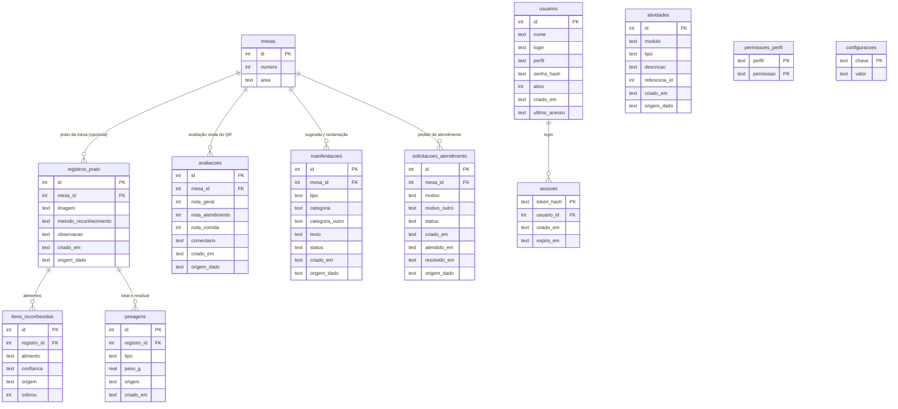

# Arquitetura do Code Meat

## Visão geral

```
code-meat/
├── run.py                     # inicia tudo: python run.py
├── requirements.txt           # sistema (obrigatório)
├── requirements-visao.txt     # reconhecimento local YOLOE (recomendado)
├── requirements-ia.txt        # Claude (opcional, pago)
├── pacotes/                   # pacote CLIP da Ultralytics (.whl) usado pelo YOLOE: instala sem Git
├── instalar_windows.bat       # Windows: cria o .venv e instala tudo (dois cliques)
├── iniciar_windows.bat        # Windows: abre o sistema usando o .venv
├── .env.example               # modelo de configuração (o .env real não vai para o GitHub)
├── backend/                   # Python + FastAPI
│   ├── main.py                # cria o app, registra os módulos e serve o frontend
│   ├── db.py                  # banco SQLite único: tabelas e funções comuns
│   ├── settings.py            # lê o .env
│   ├── auth.py                # login da equipe, sessões, perfis e permissões (verificadas no servidor)
│   ├── seed.py                # modo demonstração: dados FICTÍCIOS com média configurável
│   ├── segmentacao.py         # reconhecimento LOCAL com segmentação (YOLOE)
│   ├── vision.py              # reconhecimento pelo Claude (opcional)
│   ├── motores.py             # escolhe o motor: local, Claude ou manual
│   └── routers/
│       ├── food.py            # Pilar 1 · Reconhecimento de Alimentos
│       ├── feedback.py        # Pilar 2 · Experiência do Cliente + QR Code das mesas
│       ├── equipe.py          # Acesso da equipe: login, QR Code da equipe, colaboradores e permissões
│       └── dashboard.py       # Plataforma central: dashboard, alertas, relatórios, configurações, modo demonstração
├── frontend/                  # HTML + CSS + JavaScript, sem etapa de build
│   ├── index.html             # painel administrativo
│   ├── css/app.css            # identidade visual compartilhada
│   ├── js/app.js              # login, menu por perfil e navegação
│   ├── js/ui.js               # componentes comuns (cards, ícones, gráficos, chamadas à API)
│   ├── js/modules/
│   │   ├── overview.js        # Visão Geral
│   │   ├── food.js            # Pilar 1 (câmera, upload, contornos, conferência)
│   │   ├── customer.js        # Pilar 2 (painel)
│   │   ├── reports.js         # Relatórios (única tela com exportação CSV)
│   │   ├── equipe.js          # Equipe e acessos (administrador)
│   │   └── settings.js        # Configurações e modo demonstração
│   ├── cliente/               # Pilar 2: página do celular (QR Code da mesa)
│   ├── equipe/                # página de login da equipe (QR Code da equipe)
│   └── vendor/                # Chart.js e fonte Inter (cópias locais)
├── scripts/
│   └── avaliar_reconhecimento.py  # mede o reconhecimento em fotos reais
├── tests/
│   ├── test_integracao.py     # testes da API (pytest)
│   ├── test_reconhecimento_real.py  # modelo real com fotos reais (pula se não houver YOLOE/fotos)
│   ├── fotos_reais/gabarito.json    # o que há em cada foto (as fotos não vão para o Git)
│   └── e2e/fluxo_completo.js  # teste no navegador (Playwright)
├── docs/                      # documentação, screenshots, roteiros
└── data/                      # criado ao rodar: banco, backups, fotos, pesos do modelo e senhas iniciais (fora do Git)
```

## Por que esta arquitetura

| Decisão | Motivo |
|---|---|
| Um servidor só (FastAPI) servindo API e telas | Um comando para rodar; sem configurar CORS, Node ou dois terminais |
| SQLite | Banco em um arquivo, zero instalação, suficiente para um restaurante no protótipo |
| Frontend sem build (JS puro em módulos) | A equipe edita um arquivo e recarrega a página; não há `npm install` para quebrar |
| Atualização por *polling* (5 s) | Mais simples e estável que WebSocket para a demonstração |
| Reconhecimento local (YOLOE) como padrão | Sem custo por foto, sem internet depois do 1º download, a foto não sai do restaurante e devolve contornos (segmentação) |
| Claude como alternativa opcional | Útil sem placa de vídeo nem espaço para o PyTorch; tem custo por uso, por isso não é o padrão |
| Motor de IA isolado em `motores.py` | Trocar ou adicionar um modelo não mexe nas telas nem no banco |
| Coluna `origem_dado` em toda tabela | Separa dado demonstrativo de dado real; o modo demonstração nunca altera registros reais |
| Permissão conferida em cada rota (`auth.exigir`) | O menu por perfil é só conveniência; quem bloqueia é o servidor (401 sem login, 403 sem permissão) |
| Sessão em cookie HttpOnly + senha com PBKDF2 | Sem dependência nova (só a biblioteca padrão do Python) e sem senha guardada em texto |
| Atualização do banco ao iniciar | Colunas novas entram com `ALTER TABLE`, depois de uma cópia de segurança em `data/backups/` |

React e um banco maior (PostgreSQL) são evoluções naturais se o projeto continuar. A API já está separada por módulo para isso.

## Modelo do banco de dados



Valores padronizados:

| Campo | Valores |
|---|---|
| `mesas` | só o número e a área da mesa, usados no QR Code e nos registros |
| `itens_reconhecidos.origem` | `ia` (reconhecido pelo modelo) ou `manual` (marcado pelo operador) |
| `itens_reconhecidos.confianca` | `alta`, `media`, `baixa` (só quando veio da IA) |
| `pesagens.tipo` | `total` (prato servido) ou `residual` (sobra) |
| `pesagens.origem` | `informado`, `balanca`, `simulado` (`balanca` reservado para a integração futura) |
| `registros_prato.metodo_reconhecimento` | `ia_local` (IA local, YOLOE), `ia_claude` (IA em nuvem, opcional) ou `manual` |
| `solicitacoes_atendimento.motivo` | `Chamar garçom`, `Reposição no buffet`, `Limpeza da mesa`, `Outro` (com `motivo_outro` obrigatório). Não há pedido de conta: a casa usa comanda |
| `manifestacoes.categoria` | `Atendimento`, `Comida`, `Tempo de espera`, `Limpeza`, `Ambiente`, `Preço`, `Outro` (com `categoria_outro` obrigatório) |
| `usuarios.perfil` | `garcom`, `caixa`, `gerente`, `proprietario`, `admin` |
| `permissoes_perfil.permissao` | `painel`, `alimentos_registrar`, `alimentos_ver`, `atendimento_ver`, `atendimento_atualizar`, `cliente_ver`, `cliente_gerenciar`, `relatorios`, `configuracoes`, `usuarios` |
| `configuracoes` | `demo_media_alvo`, `demo_avaliacoes`, `demo_dias` (parâmetros do modo demonstração) |
| `manifestacoes.tipo` | `sugestao` ou `reclamacao` |
| `solicitacoes_atendimento.status` | `pendente`, `em_atendimento`, `resolvida` |
| `*.origem_dado` | `demo` (fictício, criado pelo seed) ou `real` (registrado no uso) |

Clientes são anônimos: nenhuma tabela guarda nome, telefone, e-mail ou imagem de clientes. De colaboradores, só nome, usuário e o hash da senha.

### Permissões iniciais por perfil

| Permissão | Garçom | Caixa | Gerente | Proprietário | Administrador |
|---|:-:|:-:|:-:|:-:|:-:|
| `painel` (Visão Geral) | | | ✓ | ✓ | ✓ |
| `alimentos_registrar` | | ✓ | ✓ | | ✓ |
| `alimentos_ver` | | ✓ | ✓ | ✓ | ✓ |
| `atendimento_ver` | ✓ | | ✓ | ✓ | ✓ |
| `atendimento_atualizar` | ✓ | | ✓ | | ✓ |
| `cliente_ver` | | | ✓ | ✓ | ✓ |
| `cliente_gerenciar` | | | ✓ | | ✓ |
| `relatorios` (inclui CSV) | | | ✓ | ✓ | ✓ |
| `configuracoes` | | | | | ✓ |
| `usuarios` | | | | | ✓ |

O Administrador pode mudar as colunas dos outros perfis em **Equipe e acessos**; o perfil Administrador sempre tem tudo.

## Contratos da API (integração entre módulos)

Todas as rotas devolvem JSON. A documentação interativa fica em `http://localhost:8000/docs`, onde cada rota pode ser testada pelo navegador.

**Acesso:** as rotas usadas pelo cliente no celular são públicas (envio de avaliação, sugestão/reclamação e pedido, opções, mesas e QR Codes). Todas as rotas do painel exigem login (`POST /api/auth/login`, que grava o cookie de sessão) e a permissão indicada na coluna **Permissão**. Sem login: `401`. Sem permissão: `403`.

### Acesso da equipe (`backend/routers/equipe.py`)
| Método | Rota | Permissão | Envia | Recebe |
|---|---|---|---|---|
| POST | `/api/auth/login` | pública | `{login, senha}` | `{usuario}` + cookie `codemeat_sessao` (HttpOnly, 12 h). 5 senhas erradas bloqueiam por 2 min (`429`) |
| POST | `/api/auth/sair` | pública | – | `{ok}` e apaga a sessão |
| GET | `/api/auth/eu` | logado | – | `{usuario{id, nome, login, perfil, perfil_nome, permissoes[]}}` |
| POST | `/api/auth/senha` | logado | `{senha_atual, senha_nova}` | `{ok}` |
| GET | `/api/qrcode/equipe.svg` | pública | – | QR Code que abre `/equipe/` (só a página de login) |
| GET/POST | `/api/usuarios` | `usuarios` | `{nome, login, perfil, senha}` | lista sem hash de senha / `{id}` |
| PATCH | `/api/usuarios/{id}` | `usuarios` | `{nome?, perfil?, ativo?, senha?}` | `{ok}`; encerra as sessões do colaborador |
| GET | `/api/permissoes` | `usuarios` | – | `{perfis, permissoes, matriz, padrao}` |
| PUT | `/api/permissoes/{perfil}` | `usuarios` | `{permissoes[]}` | `{perfil, permissoes}` (perfil `admin` não muda) |

### Pilar 1 · Inteligência Alimentar (`backend/routers/food.py`)
Permissões: `status` para qualquer colaborador logado; `analisar`, `registros` (POST) e `retorno` exigem `alimentos_registrar`; as consultas exigem `alimentos_ver` ou `alimentos_registrar`. As fotos em `/uploads/` também só abrem com uma dessas permissões.

| Método | Rota | Envia | Recebe |
|---|---|---|---|
| GET | `/api/alimentar/status` | – | `{ia_disponivel, modo, motor_ativo, motor, segmentacao, mensagem, motores{local, claude}, categorias[], catalogo[]}` |
| POST | `/api/alimentar/analisar` | formulário com `imagem` (JPG/PNG/WEBP, até 10 MB) | `{imagem, imagem_url, metodo, motor, itens[{alimento, confianca, confianca_pct, detalhes[]}], regioes[{tipo, alimento, detalhe, confianca_pct, confianca, identificado, regiao{x,y,largura,altura}, poligono[[x,y]...]}], objetos[], nao_identificados, tempo_ms, erro}` |
| POST | `/api/alimentar/registros` | `{mesa?, imagem?, metodo_reconhecimento, itens[{alimento, origem, confianca?}], peso_total_g?, origem_peso}` | `{id}` |
| POST | `/api/alimentar/registros/{id}/retorno` | `{peso_residual_g, origem_peso, itens_sobra[ids]}` | `{ok}` |
| GET | `/api/alimentar/registros` · `/registros/{id}` | – | registros com itens, pesos e `desperdicio_pct` |
| GET | `/api/alimentar/resumo` | – | indicadores (desperdício, mais servidos, mais sobras, por hora, métodos de reconhecimento) |

Regras do servidor: um registro só fica como `ia_local`/`ia_claude` se aquele motor estiver mesmo disponível; caso contrário vira `manual`. Coordenadas e contornos são frações de 0 a 1 da imagem. Detalhes do modelo: [RECONHECIMENTO.md](RECONHECIMENTO.md).

### Pilar 2 · Experiência do Cliente (`backend/routers/feedback.py`)
| Método | Rota | Envia | Recebe |
|---|---|---|---|
| GET | `/api/cliente/opcoes` (pública) | – | motivos de atendimento e categorias |
| POST | `/api/avaliacoes` (pública) | `{mesa?, nota_geral 1-5, nota_atendimento?, nota_comida?, comentario?}` | `{id, mensagem}` |
| POST | `/api/manifestacoes` (pública) | `{mesa?, tipo, categoria, categoria_outro?, texto}`; `categoria_outro` obrigatório se `categoria` = `Outro` | `{id, mensagem}` |
| POST | `/api/solicitacoes` (pública) | `{mesa, motivo, motivo_outro?}`; `motivo_outro` obrigatório se `motivo` = `Outro` | `{id, mensagem}` |
| POST | `/api/solicitacoes/{id}/status` (`atendimento_atualizar`) | `{status: em_atendimento ou resolvida}` | `{ok}` |
| POST | `/api/manifestacoes/{id}/resolver` (`cliente_gerenciar`) | – | `{ok}` |
| GET | `/api/solicitacoes` (`atendimento_ver`) | `?abertas=true` | fila de pedidos |
| GET | `/api/avaliacoes` · `/api/manifestacoes` · `/api/cliente/resumo` (`cliente_ver`) | `?origem=todos\|real\|demo` | listas e indicadores, com média por origem e % de satisfeitos |
| GET | `/api/cliente/periodo?dias=30` (`cliente_ver`) | `?origem=` | satisfação por dia e por período (hoje, 7 dias, 30 dias, total) |
| GET | `/api/mesas` (pública) | – | `{mesas[{id, numero, area}]}` (para os QR Codes) |
| GET | `/api/qrcode/{numero}.svg` (pública) | – | imagem do QR Code da mesa |

### Plataforma central (`backend/routers/dashboard.py`)
| Método | Rota | Permissão | Recebe |
|---|---|---|---|
| GET | `/api/dashboard` | `painel` | resumo dos dois pilares, alertas, sinais por hora, atividades, origem dos dados e estado do reconhecimento |
| GET | `/api/cabecalho` | logado | dados do topo do painel (só o que o perfil pode ver) |
| GET | `/api/alertas` | `painel`, `cliente_ver` ou `atendimento_ver` | pedidos de atendimento pendentes e reclamações novas |
| GET | `/api/atividades` | `painel` ou `relatorios` | linha do tempo |
| GET | `/api/relatorios/sinais?dias=` | `relatorios` | cruzamento dos dois pilares por horário |
| GET | `/api/relatorios/exportar/{pratos,avaliacoes,manifestacoes,solicitacoes}.csv` | `relatorios` | arquivos CSV (única exportação do sistema) |
| GET | `/api/sistema` | `configuracoes` | estado da IA, contagem real x demo, parâmetros do modo demonstração |
| POST | `/api/sistema/demo/recriar` | `configuracoes` | `{media_alvo 1-5, avaliacoes 20-2000, dias 7-90}`: troca só os dados demonstrativos |
| POST | `/api/sistema/demo/remover` | `configuracoes` | remove só os dados demonstrativos |

## Como a integração acontece

1. **Cliente → Dashboard:** `POST /api/solicitacoes` e `POST /api/manifestacoes` gravam o pedido ou a reclamação. `GET /api/alertas` mostra os pendentes no topo da Visão Geral, e o menu exibe a contagem.
2. **Foto → Modelo → Registro:** `POST /api/alimentar/analisar` passa a foto pelo motor ativo; o operador confere e `POST /api/alimentar/registros` grava itens, método e peso total.
3. **Alimentos → Dashboard:** cada registro e retorno alimenta `pesagens` e `itens_reconhecidos`, de onde saem o desperdício, a incidência de sobras e os alimentos mais presentes.
4. **Todos → Atividades:** todo módulo chama `registrar_atividade()` (em `db.py`), formando a linha do tempo única.
5. **Sinais por horário:** `dashboard.sinais_por_hora()` junta pratos, desperdício, avaliações, nota, reclamações e pedidos na mesma faixa de hora.
6. **Equipe → Fila:** o garçom entra pelo QR Code da equipe, vê a fila do cliente (`GET /api/solicitacoes`) e atualiza o status; a ação fica na linha do tempo com o nome de quem atendeu.

## Bibliotecas e licenças

| Camada | Biblioteca | Licença |
|---|---|---|
| Backend | Python 3.10+, FastAPI, Uvicorn | MIT / BSD |
| Banco | SQLite | Domínio público |
| Frontend | HTML, CSS e JavaScript (módulos ES), sem etapa de build | (da equipe) |
| Reconhecimento local | YOLOE via Ultralytics 8.4 + PyTorch + CLIP (codificador de texto, em `pacotes/`) | AGPL-3.0 (Ultralytics e fork do CLIP), BSD (PyTorch) |
| Reconhecimento opcional | Claude (Anthropic), SDK `anthropic` | MIT (SDK); uso da API é pago |
| Imagens | Pillow | MIT-CMU |
| Gráficos | Chart.js 4.4.1, salvo no repositório | MIT |
| QR Code | segno | BSD |
| Fonte | Inter | SIL Open Font License |
| Testes | pytest + Playwright | MIT / Apache-2.0 |

Detalhes do modelo e das licenças do reconhecimento: [RECONHECIMENTO.md](RECONHECIMENTO.md#referências-e-licenças).
