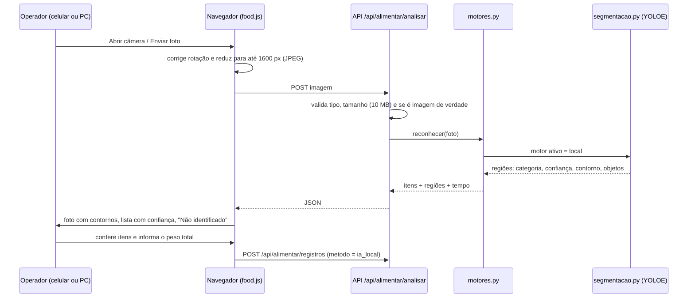

# Reconhecimento Inteligente de Alimentos (Pilar 1)

Este documento explica como o Code Meat reconhece os alimentos de uma foto de prato: tecnologia, modelo, licenças, arquitetura, como rodar, como testar no computador e no celular, resultados medidos e limitações.

## Resumo em 5 linhas

1. O operador tira a foto pela **câmera do celular** (ou envia um arquivo). Na proposta de funcionamento, uma câmera integrada à balança faria essa captura sozinha no momento da pesagem; essa integração ainda não está instalada no protótipo.
2. O modelo **YOLOE** roda **no próprio computador** (sem internet depois do 1º download, sem custo de API) e devolve cada região do prato com **categoria, confiança e contorno**.
3. Abaixo de **35%** de confiança a região aparece como **"Não identificado"**. Prato, talheres e copos são listados à parte.
4. O operador confere e salva. A balança informa só o **peso total** (no protótipo: informado ou simulado).
5. Testado com **6 fotos reais**: encontrou **14 de 23** categorias presentes e **não inventou nenhum alimento** que não estava no prato.

## Tecnologia e modelo

| Item | Escolha | Por quê |
|---|---|---|
| Modelo | **YOLOE** (`yoloe-v8l-seg.pt`), da Ultralytics | Segmentação de **vocabulário aberto**: recebe os nomes das classes em texto e devolve máscaras (contornos). Não precisa treinar para reconhecer "arroz" ou "feijão". Roda em CPU. |
| Biblioteca | `ultralytics==8.4.219` + PyTorch | Carrega o modelo, roda a inferência e entrega caixas, confianças e máscaras. |
| Codificador de texto | MobileCLIP (`mobileclip_blt.ts`) + pacote `clip` da Ultralytics | Transforma os nomes das classes em vetores que o YOLOE entende. Usado só ao carregar o modelo. |
| Alternativa opcional | **Claude** (Anthropic) via API | Reconhece pratos por descrição, mas não devolve contornos e **tem custo por uso**. Só é usado se configurado. |
| Reserva | Marcação manual | Se nenhum motor estiver disponível ou se o modelo falhar, o fluxo continua manual. |

O motor é escolhido por `MOTOR_VISAO` no `.env`: `auto` (padrão: local, depois Claude, depois manual), `local`, `claude` ou `manual`.

### Categorias reconhecidas

O pedido do restaurante foi reconhecer: **Carne, Arroz, Feijão, Batata frita, Salada, Frango, Linguiça e Acompanhamentos.** Como o YOLOE entende inglês, cada categoria é descrita por algumas frases (arquivo `backend/segmentacao.py`, lista `PROMPTS`):

| Categoria exibida | Descrições enviadas ao modelo |
|---|---|
| Carne | steak, grilled meat, ground beef, sliced beef |
| Arroz | rice, white rice |
| Feijão | beans, pinto beans, bean stew |
| Batata frita | french fries |
| Salada | salad, lettuce, cherry tomato, cucumber slices |
| Frango | chicken, grilled chicken breast, fried chicken |
| Linguiça | sausage |
| Acompanhamentos | pasta, gnocchi, mashed potato, potato salad, carrot, beet, breadcrumbs, crumbs with bacon (farofa) |
| Objetos (não são comida) | plate, bowl, fork, knife, glass |

### Regras de confiança

| Confiança do modelo | O que a tela mostra |
|---|---|
| 55% ou mais | Categoria com selo **Alta** |
| 35% a 54% | Categoria com selo **Média** |
| 20% a 34% | **Não identificado** (contorno cinza tracejado, sem nome) |
| abaixo de 20% | descartado |

Os limiares foram escolhidos olhando as fotos de teste. Por isso o resultado abaixo **não é uma medida independente de precisão**: é a comprovação de que o reconhecimento funciona em fotos reais, com a calibração usada.

## Arquitetura do reconhecimento



Arquivos:

| Arquivo | Papel |
|---|---|
| `backend/segmentacao.py` | Motor local: carrega o YOLOE uma vez, aplica as categorias, os limiares e devolve os contornos normalizados (0 a 1). |
| `backend/motores.py` | Escolhe o motor (local, Claude ou manual) e padroniza a resposta. |
| `backend/vision.py` | Motor opcional Claude. |
| `backend/routers/food.py` | Rotas `/api/alimentar/...`: análise, registro, retorno e indicadores. |
| `frontend/js/modules/food.js` | Tela: câmera, upload, pré-visualização, indicador de processamento, contornos (SVG), confiança e conferência. |
| `scripts/avaliar_reconhecimento.py` | Mede acertos em fotos reais com um gabarito. |

Formato de uma região devolvida pela API:

```json
{"tipo": "alimento", "alimento": "Arroz", "detalhe": "arroz branco", "confianca_pct": 84,
 "confianca": "alta", "identificado": true,
 "regiao": {"x": 0.47, "y": 0.23, "largura": 0.42, "altura": 0.29},
 "poligono": [[0.52, 0.24], [0.55, 0.23], "..."]}
```

## Como rodar

Na pasta do projeto, depois de `pip install -r requirements.txt`:

```bash
pip install -r requirements-visao.txt
python run.py
```

- **Não precisa de Git.** O pacote `clip` (codificador de texto do YOLOE, da Ultralytics) não existe no PyPI; por isso ele vem pronto em `pacotes/clip-1.0-py3-none-any.whl`, sem alterações (origem e licença em `pacotes/LEIAME.md`). Rode o `pip install` **dentro da pasta do projeto**.
- **Windows:** use o `instalar_windows.bat` ou um `.venv` dentro de `C:\code-meat` (passo a passo em [GUIA_EQUIPE.md](GUIA_EQUIPE.md#2-baixar-e-instalar-o-projeto)). Com o Python da Microsoft Store, sem `.venv`, o PyTorch passa do limite de caminho do Windows.
- No 1º início o servidor baixa os pesos para `data/modelos/` (cerca de 100 MB do YOLOE e 600 MB do codificador de texto). Isso acontece **uma vez** e em segundo plano; a tela mostra "o modelo carrega na primeira foto" enquanto isso.
- **Configurações** mostra se o reconhecimento local está instalado e ativo.

## Como testar

### No computador
1. Abra `http://localhost:8000/#/reconhecimento`.
2. Clique em **Enviar foto** (ou arraste uma foto de prato) ou em **Abrir câmera** (webcam).
3. Veja a foto com os contornos coloridos, a lista com a confiança de cada categoria e as regiões **Não identificado**.
4. Confira os alimentos, clique em **Gerar peso simulado** e em **Salvar registro**.

### Testar no celular
- **Pelo Wi-Fi (HTTP):** abra no celular o endereço que aparece no terminal (`http://192.168.x.x:8000/#/reconhecimento`). O botão **Tirar foto** abre a câmera nativa do celular. A pré-visualização ao vivo dentro da página não aparece porque o navegador só libera a câmera em HTTPS.
- **Com câmera ao vivo (HTTPS):** use um túnel HTTPS, por exemplo `cloudflared tunnel --url http://localhost:8000` (gratuito, sem cadastro), e abra no celular o endereço `https://...trycloudflare.com/#/reconhecimento`. O botão **Abrir câmera** aparece.
- Mensagens tratadas: permissão da câmera negada, nenhuma câmera, câmera em uso, falha no envio, arquivo que não é imagem (inclusive HEIC que o navegador não abre) e erro do modelo (cai para marcação manual).

### Medir com fotos reais
1. Coloque as fotos em `tests/fotos_reais/` (elas **não vão para o GitHub**).
2. Escreva em `tests/fotos_reais/gabarito.json` o que realmente aparece em cada foto.
3. Rode `python -m scripts.avaliar_reconhecimento tests/fotos_reais`. As imagens com contornos ficam em `tests/fotos_reais/resultado/`.
4. `python -m pytest -q` também roda esse teste quando o YOLOE está instalado (critérios fixados antes: pelo menos 50% das categorias encontradas, pelo menos 90% de precisão e ao menos um acerto por foto).

## Resultados com fotos reais

Seis fotos reais de pratos (fotos de celular enviadas pela equipe, não fornecidas pela Bovinu'S), computador sem placa de vídeo (CPU Intel Xeon 2,1 GHz, 4 núcleos), modelo `yoloe-v8l-seg`, imagem de 640 px na inferência.

| Foto | O que tem no prato (gabarito) | Encontrou | Não encontrou | Inventou | Tempo |
|---|---|---|---|---|---|
| IMG_6162 | arroz integral, frango, salada, legumes | Arroz, Frango, Acompanhamentos (legumes) | Salada | nada | 0,6 s |
| IMG_6163 | carne, massa (nhoque) | Carne | Acompanhamentos (massa) | nada | 0,4 s |
| IMG_6164 | arroz, feijão, carne moída, salada | Arroz, Salada | Feijão, Carne | nada | 0,5 s |
| IMG_6165 | carne na chapa, arroz, batata frita, vinagrete, molho | Carne, Salada | Arroz, Batata frita, Acompanhamentos | nada | 0,6 s |
| IMG_6166 | carne, linguiça, arroz, farofa, maionese | Arroz, Linguiça, Acompanhamentos (maionese) | Carne | nada | 0,5 s |
| IMG_6167 | arroz, feijão, salada, frango | Arroz, Feijão, Salada | Frango | nada | 0,6 s |

**Total:** 14 de 23 categorias encontradas (61%). Nenhuma categoria inventada (precisão de 100% por categoria). O teste automático `tests/test_reconhecimento_real.py` passou com esses números.

Observações honestas, conferidas olhando os contornos:
- Na foto IMG_6166 a região marcada como **Arroz** fica sobre a **farofa** (que está por cima do arroz). A categoria existe no prato, mas aquele contorno está errado.
- **Frango** grelhado foi encontrado em uma de duas fotos; na outra os pedaços ficaram como "Não identificado".
- **Feijão** e **carne moída** misturados no prato ficaram abaixo do limiar em IMG_6164.
- Em IMG_6165, o arroz está numa tigela separada e a região inteira foi detectada como "tigela" (objeto, 93%), não como arroz. A batata frita, pequena no canto da foto, não foi encontrada.

### Como o modelo foi escolhido

As mesmas 6 fotos foram testadas com 3 tamanhos de YOLOE (limiar de 30% nesta comparação):

| Modelo | Categorias corretas | Alimentos inventados | Tempo médio |
|---|---|---|---|
| yoloe-11m-seg (lista inicial de nomes) | 10 de 23 | 2 | 0,27 s |
| yoloe-11l-seg, imagem 960 px | 16 de 23 | 2 | 0,63 s |
| **yoloe-v8l-seg, imagem 640 px** | **15 de 23** | **0** | **0,46 s** |

Foi escolhido o `yoloe-v8l-seg` por não inventar alimentos e ser rápido em CPU. Troque com `YOLOE_MODELO` no `.env` se quiser testar outro.

## Implementado, simulado e planejado

| Item | Situação |
|---|---|
| Captura pela câmera (getUserMedia) e câmera nativa do celular | ✅ Implementado e testado (navegador com câmera emulada e foto real) |
| Upload de foto (arquivo, galeria, arrastar) | ✅ Implementado e testado |
| Reconhecimento local com segmentação (contornos) | ✅ Implementado e testado com fotos reais |
| Confiança por alimento e "Não identificado" | ✅ Implementado |
| Separação comida × objetos (prato, talher, copo) | ✅ Implementado |
| Claude como alternativa | ✅ Implementado (opcional, testado com resposta simulada nos testes automáticos, sem gastar a API) |
| Peso total do prato | ⚠️ Informado ou **simulado**; sem balança conectada |
| Peso por alimento | ❌ Não existe, de propósito |
| Câmera integrada à balança (foto capturada sozinha na pesagem) | 🔜 Proposta de funcionamento, ainda não instalada no protótipo |
| Ajuste fino com fotos da Bovinu'S e balança USB/Bluetooth | 🔜 Planejado |

## Limitações

- O YOLOE **não foi treinado com comida brasileira**. Ele reconhece bem itens com forma clara (arroz, tomate, pepino, linguiça) e erra mais em itens misturados (farofa sobre arroz, carne moída, feijão com caldo). O operador sempre confere.
- O resultado depende de luz e ângulo: foto **de cima**, prato inteiro, boa iluminação.
- O teste usou só 6 fotos e os limiares foram ajustados nelas. Para números confiáveis é preciso um conjunto maior, separado do usado na calibração.
- A instalação do PyTorch é grande (1 a 3 GB) e, no Windows, pode falhar com caminhos longos (use o `.venv` em `C:\code-meat`, criado pelo `instalar_windows.bat`). Os scripts `.bat` foram conferidos, mas ainda não rodados num Windows real.
- A câmera ao vivo no celular exige HTTPS.

## Referências e licenças

| Projeto | Uso no Code Meat | Licença |
|---|---|---|
| **Ultralytics / YOLOE** (github.com/ultralytics/ultralytics) | Biblioteca e pesos pré-treinados, usados sem modificação | **AGPL-3.0**. Para uso comercial fechado, a Ultralytics exige licença Enterprise. O Code Meat é um protótipo acadêmico de código aberto. |
| **CLIP** (fork da Ultralytics, baseado no CLIP da OpenAI) e **MobileCLIP** (Apple) | Codificação dos nomes das classes. O pacote `clip` vai junto do projeto em `pacotes/` (sem alterações, para instalar sem Git) | AGPL-3.0 (fork da Ultralytics; o CLIP original é MIT) / licença Apple (pesos MobileCLIP) |
| **PyTorch** | Execução do modelo | BSD-3-Clause |
| **FoodSAM** (Lan et al., 2023) | **Só referência conceitual**: ideia de combinar segmentação genérica com classes de comida e separar comida de objetos. Nenhum código, peso ou arquivo foi copiado. | Apache-2.0 |
| **FoodSeg103** (benchmark, base MMSegmentation) e **FoodInsSeg** | **Só referência conceitual** sobre segmentação de alimentos e categorias de comida. Nenhum dado, peso ou código foi usado. | FoodSeg103: Apache-2.0. FoodInsSeg: conforme os autores (não usado) |

Todo o código do Code Meat (integração, categorias, limiares, telas, câmera, testes) foi escrito pela equipe.
